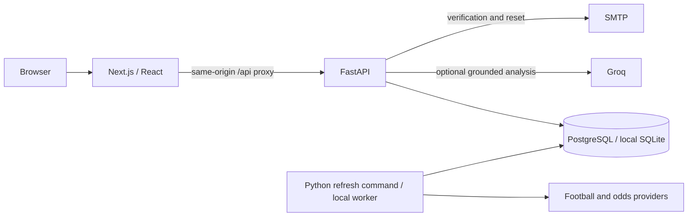

# Architecture and implementation milestones

## Services

Next.js 16 / React / TypeScript renders the responsive application. Tailwind's PostCSS integration and an original CSS component system supply the light theme. Reviewed local crests cover the current 180-team cache; shared badges try a supplied provider image and then initials when needed. No remote fonts are used. Webpack is used for builds and development because this workstation restricts Turbopack's CSS subprocess socket. Python 3.13, FastAPI, SQLAlchemy 2 and Alembic form one backend. PostgreSQL is the deployment database; SQLite is a genuine persistent local convenience, **not** a multi-worker substitute.

The personal hosted demonstration uses a manual one-shot refresh command; the optional GitHub schedule stays disabled. Local previews run a separate long-running worker. Both share the four-hour fixture/results and three-day odds cadence. A dedicated PostgreSQL connection in AUTOCOMMIT mode holds a session advisory lock across ingestion commits without leaving an idle transaction open. Jobs have unique mode/model-version/time-bucket keys, state and sanitized failure details. Quota attempts are persisted before requests. Expired auth tokens and sessions are removed on worker ticks. There is no Redis or independent inference microservice; Groq is an optional external chat provider, separate from the Python probability model.

## Reviewable milestones

1. **Browse and research:** `model.py`, `providers.py`, `ingestion.py`, `research.py`; persist synthetic history, fit coherent probabilities, record actual adapter quotes, search ranges and inspect provenance. Verify `pytest backend/tests/test_model.py backend/tests/test_research.py` and `/predictions` → match detail → `/parlays`.
2. **Personal records:** `auth.py` and saved endpoints; verified accounts, Argon2 passwords, signed session cookies backed by revocable server session records, CSRF and ownership checks. Verify `pytest backend/tests/test_accounts.py` and the full browser flow.
3. **Evidence and operations:** append-only publications and settlement revisions, evaluator, performance archive, protected ingestion status, deployment and provider documentation. Run `python -m app.cli evaluate` and inspect `/performance`; synthetic outputs are visibly separated.

See README for exact start commands used by every milestone.

## Persistence choices

Competitions include a season value and explicit provider league identity; the top five domestic leagues and three European competitions are supported, with European upcoming coverage bounded to 14 days. Team and fixture IDs are canonical UUIDs with unique prefixed provider IDs. Reviewed cross-provider aliases have a unique provider/type/external-ID constraint. Fixtures hold mutable provider status, regulation goals and half-time goals. Quote snapshots store decimal precision, bookmaker, fixed market code, source timestamp and fetch timestamp. Markets and outcomes are bounded enums in code, avoiding unnecessary catalog tables for the supported market catalog. Dedicated richer team-statistics tables are deferred; currently the only model inputs are fixture results.

Predictions retain model version, generation time, cutoff, history fetch time, predicted kickoff, input hash, probabilities and structured model factors. Publications point to exact predictions and quotes. Saved picks and official recommendations point to publications. Recommendations are unique per fixture and immutable. Browser parlay selections/saves are stored locally and are analyzed by the server. SQLAlchemy guards immutable version changes; the PostgreSQL migration additionally blocks UPDATE/DELETE through database triggers. Settlement corrections create revisions linked to their predecessor. The fixture source state is mutable, but an old probability or price is never rewritten. A price snapshot is an observation, not evidence that a bet could be executed.

Evaluation runs persist structured reports. Baseline explanations render persisted model factors and prediction IDs. Optional chat selects grounded evidence through Groq and falls back to a clearly labelled data-backed answer; chat text is not retained on the server. The explicitly synthetic demo populates results and half-time scores. Live ingestion never substitutes demo results. Injuries, xG and standings are not populated. Model artifacts are recomputed by a worker; model version/factors and cutoff provide a compact audit trail. Full source-history correction versions are a remaining limitation for exact long-term replay after provider corrections.

## Security controls and limits

- pwdlib Argon2id hashes; Starlette signed, HttpOnly, SameSite=Lax session cookies; random session references checked against server-side expiry/revocation on every protected request. Login rotates the session; reset revokes all account sessions.
- Random reset/verification tokens are SHA-256 hashed at rest, 30-minute, single-use, row-locked on PostgreSQL. SMTP delivery is optional locally; only demo mode may return the test email link. No default administrator; explicit local CLI promotion writes an audit event.
- Cookie mutations require exact configured Origin plus a synchronizer CSRF token in the signed session. All saved-record reads/deletes are owner-scoped. Account deletion requires password confirmation.
- ORM queries, bounded filters/page sizes, finite numbers, 32 KiB request body limit, controlled ordering, fixed provider hosts, request timeouts, sanitized errors, React text rendering, restricted same-origin proxy and security headers.
- Auth mutations: 20/minute per observed client IP; other API calls: 180/minute. Production uses shared atomic database counters in fixed calendar-minute windows, with short-lived keyed IP digests and no raw IP storage. Development retains the in-process rolling window. Behind the Next proxy, visitors may share a proxy budget until hosted client-IP behavior is validated; the app never trusts arbitrary forwarding headers. Correct trusted-edge identity remains necessary before scaling.
- No permissive CORS, arbitrary URL fetch, HTML rendering of provider text, client secrets, payment operations or AI content execution.
- CSP currently permits inline scripts/styles required by this Next setup; a per-request nonce policy is future hardening. Production HTTPS/HSTS and reverse-proxy body limits must be set at the edge. Error hooks are structured JSON logs, not an integrated paid monitoring service.

The code is not a claim of complete security or legal compliance. Draft legal pages, email deliverability, domain ownership, jurisdictions, provider contracts, backup controls and operational load limits need operator review.

## API map

Interactive specification: `/api/docs`; machine-readable OpenAPI: `/api/openapi.json`.

- GET `/api/meta`, `/api/fixtures`, `/api/predictions`, `/api/research`
- GET `/api/fixtures/{id}`, `/api/fixtures/{id}/odds-history`
- GET `/api/matchday`, `/api/matchday/{id}`, `/api/recommendations`
- POST `/api/parlays/analyze`; GET `/api/parlays/suggestions`
- POST `/api/chat`, `/api/prices/refresh` (bounded market-detail lookup)
- GET `/api/performance?page=1` (official-pick archive and latest evaluation)
- GET `/api/auth/csrf`, `/api/auth/me`; POST register/login/logout/verify/request-reset/reset
- PUT `/api/auth/preferences`; DELETE `/api/auth/account`
- GET/POST `/api/saved`; DELETE `/api/saved/{id}`
- GET `/api/admin/status` (administrator only)
- GET `/api/health`, `/api/ready`

Failures use `{ "error": { "message": "…", "fields": [...] } }`. GET searches are side-effect-free and never call providers. Filters serialize to URL parameters. `start` and `end` must both be timezone-aware, end-exclusive, ≤31 days apart. Matchday today/tomorrow filters use Europe/Belgrade calendar boundaries; kickoff display uses the browser timezone. Display time uses the account timezone if supplied. Matchday and parlay prices use decimal odds.

Search currently joins persisted publications then filters/ranks in Python, with bounded output pagination. This is intentionally readable for the current eight-competition fixture set; replace with SQL window functions for latest snapshots and SQL filtering, and benchmark before enlarging coverage or long-term archives. Performance reporting uses each official recommendation’s frozen original publication, including both wins and losses.

Prediction training, recent form and evaluation are isolated by league. The five-league catalog also drives live provider requests and demo club identities. Reasons are derived on the server from saved model factors and supplied for each market outcome. Featured recommendations use the earliest upcoming Europe/Belgrade calendar matchday and kickoff ordering, while immutable historical recommendation records remain available to Performance.
